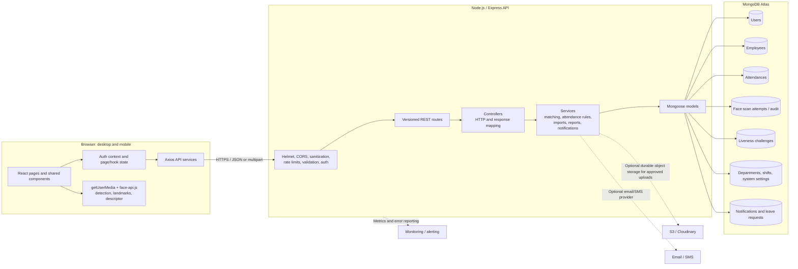
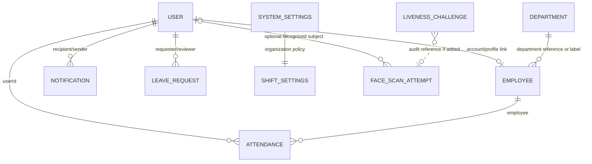

# Smart Attendance System — Project Plan and Technical Architecture

**Status:** Architecture and delivery plan  
**System context:** Existing React/Vite, Express, and MongoDB application  
**Target scale:** 1,000+ people and at least 50 concurrent scan sessions  
**Primary clients:** Desktop and mobile browsers

## 1. Executive summary

Build on the existing application rather than replace it. The current system
already has React routes and admin pages, JWT authentication and role
middleware, separate `User` and `Employee` models, attendance session logic,
CSV import and face enrollment, a public live-camera kiosk, MongoDB Atlas
integration, and reporting APIs. This plan organizes those capabilities into
a production delivery roadmap and identifies the work needed to validate
security, capacity, and operability at the stated scale.

The browser currently detects faces and extracts 128-value descriptors with
face-api.js. It sends the descriptor and a proof tied to a short-lived,
single-use server challenge. Blink/head-turn checks are best-effort UI checks;
they are not trusted proof of physical presence and do not provide robust
presentation-attack detection (PAD). Do not claim otherwise or use them alone
for high-assurance identity verification.

## 2. System architecture

### 2.1 Logical architecture



### 2.2 Request and data boundaries

- React owns presentation and transient state. The browser camera is accessed
  only after a user action and with explicit browser permission.
- The API is authoritative for authentication, authorization, attendance
  policy, descriptor matching, duplicate prevention, and persistence.
- Browser-derived landmark signals can be forged by a modified client. Treat
  them as a usability check only. If the threat model requires reliable PAD,
  add a validated server-side PAD/capture solution and assess privacy and
  operating costs before release.
- Do not send raw attendance camera frames to a third party. Enrollment-photo
  storage is a separate, explicit policy decision; current import behavior
  extracts descriptors in the browser and does not upload those photos to
  persist them.
- All timestamps are stored in UTC. Convert to the configured organization
  time zone for attendance date keys, rules, and display (currently
  `Africa/Addis_Ababa`).

### 2.3 MongoDB relationship diagram



`User` is the authentication identity and role record; `Employee` is the
employment profile. Admin and HR are roles on a user account, not a separate
admin collection. Attendance may refer to a linked user, employee profile, or
both, matching legacy/unlinked data compatibility.

## 3. Feature breakdown: epics, stories, and tasks

### Epic 1 — Authentication and authorization

**Stories**
- As an administrator or HR user, I can sign in securely and access only the
  functions permitted by my role.
- As a signed-in user, I can inspect my identity and end my session.
- As an administrator, I can provision, deactivate, and assign user roles.

**Tasks**
- Keep passwords hashed with bcrypt; enforce password and account status
  checks; avoid returning password/hash fields.
- Retain JWT auth and middleware; document token expiry, storage, refresh or
  re-login behavior, and logout semantics.
- Apply least-privilege route policy tests for admin, HR, employee, and public
  kiosk access.
- Rate-limit login; audit authentication failures without recording secrets.
- Decide whether browser token storage should move from local storage to
  secure, HttpOnly cookies; document CSRF controls if adopting cookies.

### Epic 2 — Employee management

**Stories**
- Admin/HR can search, filter, paginate, view, create, update, deactivate,
  and remove employee profiles as allowed.
- Employee users can view their permitted profile and attendance history.

**Tasks**
- Keep the `Employee` profile and `User` account lifecycles explicit; support
  unlinked employee profiles where operationally required.
- Validate employee IDs, email uniqueness, status, and department on both
  client and server.
- Add pagination and bounded search; avoid returning descriptors in ordinary
  employee-list responses.
- Invalidate face-candidate cache after profile, status, or descriptor
  changes.
- Provide a deletion/deactivation workflow that preserves required attendance
  history while removing biometric data when policy requires it.

### Epic 3 — Bulk registration

**Stories**
- Admin can download a template, upload CSV and matching photos, review
  validation results, and import valid employees.
- Admin receives per-row results and can safely retry failed rows.

**Tasks**
- Keep file type/size/row limits server-enforced; validate CSV headers, row
  data, duplicate IDs/emails, photo mapping, and descriptor quality.
- Preview without writes; return stable row identifiers and actionable error
  messages.
- Make registration idempotent or provide a deterministic duplicate policy.
- Process within configured limits; show progress and cancellation on the
  client; avoid misleading all-or-nothing success.
- Invalidate the matcher cache after successful enrollment.
- Ensure temporary uploads are removed on both success and failure; scan or
  reject untrusted files and avoid serving uploaded files as executable
  content.

### Epic 4 — Live attendance

**Stories**
- Employee/student can choose check-in or check-out and receive clear camera,
  face-count, verification, and result feedback.
- Attendance is recorded once per permitted session and date, using the
  organization shift and time-zone rules.
- A failed or ambiguous scan does not create a successful attendance record.

**Tasks**
- Require HTTPS outside local development; obtain camera only after an
  explicit action and stop media tracks on every exit/reset path.
- Verify one face, descriptor dimensions/range, matching threshold, challenge
  expiry/replay, shift eligibility, and session transitions.
- Use atomic database conditions and unique indexes for duplicate prevention;
  return a stable conflict response for concurrent scans.
- Replace per-process-only assumptions with shared rate limiting/cache or
  explicitly validate a single API instance before scaling horizontally.
- Load-test realistic camera inference and API workloads with at least 50
  concurrent sessions; size rate limits to avoid penalizing users behind a
  shared NAT.
- Add a threat-model gate before describing any blink/head-turn implementation
  as anti-spoofing.

### Epic 5 — Reporting and analytics

**Stories**
- Admin/HR can inspect daily attendance, filter a bounded date range, review
  summary metrics, and export CSV.
- Employees can inspect only their own records.

**Tasks**
- Enforce range, filter, pagination, and role validation server-side.
- Use indexed query paths and bounded projections; stream large CSV exports.
- Escape spreadsheet formula prefixes on exported text cells.
- Verify aggregation results against attendance-session rules and local
  calendar boundaries.
- Define retention and correction policies for exported and stored records.

### Epic 6 — Notifications

**Stories**
- Relevant users receive in-app attendance or administrative notices.
- Admin/HR can send supported organization announcements.

**Tasks**
- Define event taxonomy, recipient rules, delivery preferences, and retry
  behavior.
- Keep notifications out of the critical attendance write path when possible;
  use a durable queue/outbox before external email/SMS integration.
- Add read/unread state and authorization tests; rate-limit broadcast actions.
- Integrate an email/SMS provider only after consent, privacy, and cost review.

### Epic 7 — Admin dashboard

**Stories**
- Admin sees current-day totals and operational exceptions.
- Admin can navigate to employee management, attendance, reports, settings,
  users, and import tools.

**Tasks**
- Define metric semantics (present, late, absent, leave, pending/unknown).
- Use server-side aggregation and cache only where invalidation is reliable.
- Provide loading, error, empty, stale-data, and responsive states.
- Add accessibility checks for keyboard use, labels, contrast, and reduced
  motion.

## 4. Database design

The collection names below are logical names; confirm actual Mongoose
collection naming before migrations.

| Collection | Main fields | Relationships and use |
|---|---|---|
| `users` | `fullName`, `email`, `passwordHash`, `role`, `isActive`, `employeeId`, `employeeRef`, `faceDescriptor`, `avatar` | Authentication identity; roles include admin/HR/employee. `faceDescriptor` is sensitive biometric data. |
| `employees` | `employeeId`, name fields, email, department, position, status, `user`, `faceEncoding`, photo metadata | Employment profile; may be unlinked from `User` for legacy or import cases. |
| `attendances` | `userId`, `employee`, `employeeId`, `date`, check-in/out session timestamps, status, confidence, scan metadata | Daily attendance and session transitions. Preserve legacy references and existing business rules. |
| `faceScanAttempts` | outcome, reason, optional user/employee ID, distance, IP, device, timestamps | Security/audit events; never persist submitted descriptor vectors. |
| `livenessChallenges` | action, expiry, consumed timestamp, timestamps | One-use challenge records; short TTL. Does not establish trusted PAD. |
| `departments` | name, code, status | Organization taxonomy. |
| `shiftSettings` / `systemSettings` | time-zone, schedule, grace, lunch and policy fields | Organization attendance and display configuration. |
| `notifications` | recipient, sender, type, subject, message, read state | In-app communication. |
| `leaveRequests` | requester, range, type, status, reviewer | Absence/leave workflow. |

### Index plan

- Unique normalized `users.email`; unique employee IDs on employee profiles
  and user accounts where the data model permits.
- Unique attendance identity/date key. Existing system indexes include
  user/date, employee/date, and employeeId/date constraints; reconcile these
  against existing data before changing them.
- Attendance query indexes for `{date, status}`, `{department, date}`, and
  `{userId, timestamp}` only where query plans and usage justify them.
- Face candidate queries should use active/registered filters and exclude
  descriptor fields from unrelated projections.
- TTL for liveness challenges at expiry and face-scan audit after the chosen
  retention window. TTL deletion is asynchronous; never treat it as an exact
  deadline.
- Validate index creation in a staging copy and resolve duplicates before
  enabling unique constraints in production.

### Retention, privacy, and data lifecycle

- Attendance records: retain according to employment, educational, and local
  legal policy; establish a configurable retention period before production.
- Face descriptors and images: classify as sensitive biometric data; encrypt
  in transit and at rest, restrict access, log administrative access, obtain
  required notice/consent, and define deletion on withdrawal or account
  closure subject to legal retention.
- Failed scan audits: current implementation is designed for 90-day TTL
  retention; review legal and security requirements before adopting.
- Liveness challenges: expire shortly after issuance and remove with TTL.
- Temporary bulk files: delete promptly after processing, including on errors.
- Backups: define encryption, retention, restore tests, and deletion behavior
  for expired biometric material in backup snapshots.

## 5. REST API design

Base path: `/api`. Use HTTPS in all hosted environments. The current app
already exposes many of these endpoints; the table summarizes the contract
and calls out planned additions. Keep the existing endpoint behavior stable
while documenting versioning and deprecation.

| Method and path | Access | Purpose / payload |
|---|---|---|
| `POST /auth/login` | Public, rate-limited | `{ "email": "...", "password": "..." }`; returns user-safe identity and bearer token. |
| `GET /auth/me` | Authenticated | Current identity and role. |
| `POST /auth/logout` | Authenticated | Ends client session / invalidates session if server-side token tracking is adopted. |
| `GET /employees?page=1&limit=25&search=...` | Admin/HR | Paginated employee list and filters. |
| `GET /employees/:id` | Admin/HR | Profile details; omit biometric vector. |
| `POST /employees` | Admin | Create profile. |
| `PUT /employees/:id` | Admin | Update profile. |
| `DELETE /employees/:id` | Admin | Deactivate or delete under retention policy. |
| `POST /employees/bulk/preview` | Admin, multipart | CSV and optional photos; validates only, no writes. |
| `POST /employees/bulk/import` | Admin | Import valid rows with per-row results. |
| `POST /face/bulk-preview` | Admin, multipart | Face-oriented CSV/photo validation. |
| `POST /face/register` | Admin | Enroll a single descriptor after validation. |
| `POST /face/bulk-register` | Admin, rate-limited | Register one validated employee/descriptor row. |
| `POST /attendance/liveness/challenge` | Public kiosk, rate-limited | Returns `{challengeId, action, expiresAt}`. |
| `POST /attendance/scan` | Public kiosk, scan-limited | `{faceDescriptor:[128 numbers], livenessProof:{challengeId, action, durationMs, observedFrames}}`; records check-in/session transition. |
| `POST /attendance/checkout` | Public kiosk, scan-limited | Same scan payload; records allowed check-out transition. |
| `GET /attendance/kiosk-status` | Public kiosk | Current shift/kiosk state. |
| `GET /attendance/today` | Admin/HR | Current organization-local date records. |
| `GET /attendance/report?from=YYYY-MM-DD&to=YYYY-MM-DD&page=1&limit=50` | Admin/HR | Bounded, paginated report. |
| `GET /attendance/export?from=...&to=...` | Admin/HR | Streaming formula-safe CSV. |
| `GET /attendance/my` | Employee/self | Own records. |
| `GET /attendance/dashboard` | Admin/HR | Dashboard counts and summaries. |
| `GET /notifications` | Authenticated | Current user's notifications. |
| `PATCH /notifications/:id/read` | Authenticated/owner | Mark notification as read. |
| `GET /shifts` / `PUT /shifts` | Admin for updates | Read/update organization shift policy. |

### Authentication and authorization flow

1. Client submits credentials over HTTPS to `/auth/login`.
2. Server validates input, applies login rate limiting, verifies bcrypt hash
   and active status, then signs a short-lived JWT with least-privilege
   identity claims.
3. Client sends `Authorization: Bearer <token>` to protected routes. Middleware
   verifies signature/expiry and enforces admin, HR, employee, or owner policy.
4. Logout clears client credentials. If immediate token revocation is a
   requirement, add a session/token-version strategy; stateless JWT logout
   alone cannot revoke a copied token.
5. Public kiosk routes do not imply anonymous access to admin data. Restrict
   each endpoint independently, validate payloads, rate-limit, and use
   generic messages where details would expose registered-user information.

### Example: login

```http
POST /api/auth/login
Content-Type: application/json

{"email":"admin@example.org","password":"<redacted>"}
```

```json
{
  "success": true,
  "data": {
    "token": "<short-lived-jwt>",
    "user": {"id": "66b...", "fullName": "Admin User", "role": "admin"}
  }
}
```

Never log request passwords or return password hashes.

### Example: attendance scan

```http
POST /api/attendance/scan
Content-Type: application/json

{
  "faceDescriptor": [0.01, -0.02],
  "livenessProof": {
    "challengeId": "66b000000000000000000000",
    "action": "blink",
    "durationMs": 4200,
    "observedFrames": 12
  }
}
```

The sample descriptor above is abbreviated for readability; the API requires
exactly 128 finite values. A successful response reports the action, employee
summary, attendance session, and timestamp without returning biometric data.

### Example: validation error and error contract

```json
{
  "success": false,
  "error": {"code": "VALIDATION_ERROR", "details": [{"field": "from", "message": "from must use YYYY-MM-DD."}]},
  "message": "Request validation failed."
}
```

| HTTP | Code | Meaning |
|---|---|---|
| `400` | `VALIDATION_ERROR` | Invalid fields, descriptor, date range, or attendance policy state. |
| `401` | `UNAUTHENTICATED` | Missing, invalid, or expired credentials on a protected endpoint. |
| `403` | `FORBIDDEN` / `LIVENESS_FAILED` | Insufficient role or invalid/expired/replayed challenge. |
| `404` | `NOT_FOUND` / `FACE_NOT_RECOGNIZED` | Resource unavailable or no acceptable face match. Avoid leaking unnecessary identity details. |
| `409` | `DUPLICATE` / `ATTENDANCE_CONFLICT` | Duplicate employee identity or concurrent/recent attendance action. |
| `413` | `FILE_TOO_LARGE` | Upload exceeds enforced size limit. |
| `415` | `UNSUPPORTED_MEDIA_TYPE` | File or request media type is not accepted. |
| `429` | `RATE_LIMITED` | Login, API, upload, or scan rate exceeded. |
| `500` | `INTERNAL_ERROR` | Unexpected server failure; return a correlation ID, not stack traces. |
| `503` | `DEPENDENCY_UNAVAILABLE` | Database or required provider unavailable. |

## 6. UI/UX wireframes and user flows

### 6.1 Page layouts

**Admin shell (desktop)**

```text
+----------------------+-----------------------------------------------+
| Brand / collapse     | Page title                    Search  Profile |
| Dashboard            +-----------------------------------------------+
| Employees            | Breadcrumbs / filters / primary action         |
| Bulk registration    |                                               |
| Live attendance      | Main content: cards, charts, or data table     |
| Attendance logs      |                                               |
| Reports              |                                               |
| Users / settings     |                                               |
+----------------------+-----------------------------------------------+
```

**Employee dashboard**

```text
+--------------------------------------------------------------+
| Logo                         Notifications       My profile   |
+--------------------------------------------------------------+
| Good morning, Name          Today: status / check-in time     |
| Attendance summary          Recent history table              |
| Leave / notices             Profile and help links             |
+--------------------------------------------------------------+
```

**Bulk registration**

```text
Step 1: Download template
Step 2: Drop CSV + photos   [file rules and selected-file list]
Step 3: Preview             [valid / invalid counts + row errors]
Step 4: Confirm import      [progress, cancel, row-by-row results]
Step 5: Summary             [download result report / retry failures]
```

**Live kiosk**

```text
Attendance Set                        Local date and time
                         [Check In] [Check Out]
               +-----------------------------------+
               | Live video | one-face frame      |
               | instruction / scan feedback       |
               +-----------------------------------+
               Result overlay: success / next step / retry
```

**Reports**

```text
Date range | Department | Status | Search | Apply / Export CSV
KPI cards: present / late / absent / leave
Chart: attendance trend
Table: employee, date, check-in/out, status, confidence
Pagination and accessible empty/error states
```

### 6.2 Key user flows

- **Admin registration:** sign in → Employees → download template → select
  CSV/photos → preview validation → correct errors → confirm import → inspect
  per-row results.
- **Attendance:** open kiosk → choose check-in/out → grant camera permission
  → follow one-face/challenge guidance → receive success/conflict/retry result.
- **Report:** sign in → Reports → select bounded date range/filters → review
  summary → export CSV.
- **Employee self-service:** sign in → dashboard → review own attendance and
  notices; any attendance correction follows an authorized request flow.

### 6.3 Responsive behavior and accessibility

| Breakpoint | Layout |
|---|---|
| Mobile: `<640px` | Sidebar becomes a drawer/bottom navigation; single-column cards; tables become scrollable or card rows; camera frame fills available width. |
| Tablet: `640–1023px` | Collapsible rail; two-column summaries; filter controls wrap; keep touch targets at least 44px. |
| Desktop: `>=1024px` | Persistent collapsible sidebar, 3–4 KPI columns, dense but readable tables. |

Use semantic headings, visible focus, keyboard-operable dialogs and menus,
labels and error associations, WCAG AA contrast targets, reduced-motion
support, and non-color-only status cues. Ensure the kiosk remains usable with
large text and landscape/portrait device orientations.

## 7. Technology choices and trade-offs

- **React rather than Vue/Angular:** the repository already uses React 18,
  shared components, Vite, and established route/state patterns. Reusing this
  avoids migration cost and supports a component-driven admin UI. Vue or
  Angular could also deliver the product; this is a fit-to-project decision,
  not a universal ranking.
- **Node.js/Express rather than Python/Django:** the API is already
  JavaScript/Node, so DTO validation and face-related workflows can share
  language and deployment tooling with the browser application. Python has a
  stronger ecosystem for server-side computer vision and ML; if robust PAD or
  large-scale inference becomes required, isolate that capability behind a
  service rather than forcing it into Express.
- **MongoDB rather than PostgreSQL:** Atlas and Mongoose are already used,
  employee/profile data contains evolving fields, and the application uses
  document-oriented face descriptors. MongoDB is not inherently superior for
  relational attendance data: PostgreSQL offers strong relational constraints
  and reporting joins. Reassess if cross-entity transactional reporting,
  auditability, or relational integrity becomes the dominant requirement.
- **face-api.js rather than alternatives:** it is already integrated and
  performs browser-side detection/descriptor extraction without sending raw
  frames to a server. Browser CPU/GPU differences, model licensing, matching
  accuracy, and liveness limitations must be benchmarked. Alternatives
  include MediaPipe for detection/landmarks, a vetted commercial PAD/biometric
  provider, or server-side inference; select only after a privacy, cost,
  latency, and accuracy evaluation.

## 8. Development roadmap

The requested durations total six weeks and assume a small team, prompt
stakeholder decisions, existing code reuse, and no major compliance or model
retraining work. Treat durations as planning estimates, not guarantees.

| Phase | Duration | Scope | Exit criteria |
|---|---:|---|---|
| 1. MVP | 2 weeks | Authentication/roles, employee CRUD, face enrollment, kiosk check-in/out, core attendance persistence. | Role tests pass; demo with representative data; no duplicate attendance under concurrent request test. |
| 2. Polish | 1 week | Responsive UX, validation, empty/error/loading states, import reporting, accessibility, edge cases. | Mobile/desktop QA checklist passes; import failure/retry paths verified; no critical/high defects. |
| 3. Advanced | 2 weeks | Liveness UX/PAD decision, reports/export, notifications, dashboard analytics, audit and retention policies. | Threat model approved; exports and local time boundaries verified; notification failure does not block attendance. |
| 4. Deploy | 1 week | CI/CD, staging/prod configuration, Atlas index review, monitoring, backup/restore and load checks. | Staging smoke test, rollback and restore exercises, 50+ concurrent scan test and operational runbook complete. |

**Suggested sequencing:** first confirm privacy/legal requirements, attendance
rules, and deployment ownership; then stabilize model relationships and
indexes; implement API and UI increments; run unit/integration tests in CI;
hold production rollout until a staging load test and backup restore succeed.

## 9. Deployment strategy

### Environments and hosting

- **Frontend:** Vercel or Netlify static hosting for the Vite build; configure
  exact production API origin, HTTPS, restrictive CSP, and no secrets in
  `VITE_*` variables.
- **Backend:** Railway/Render for a simple managed start, or AWS EC2/container
  service for greater network and autoscaling control. Deploy stateless API
  replicas behind HTTPS load balancing. Store secrets in the platform secret
  manager.
- **Database:** MongoDB Atlas with private networking/IP allowlists, least
  privilege database credentials, encryption, backups/PITR appropriate to
  the plan, and a staging database separate from production.
- **File storage:** Prefer no persisted face-photo storage unless justified.
  For approved employee/import files use private S3/Cloudinary storage,
  short-lived signed URLs, encryption, malware/type validation, and lifecycle
  deletion. Do not use public buckets for biometric material.
- **CI/CD:** GitHub Actions to install from lockfiles, lint/type-check,
  run unit/integration tests, build frontend, scan dependencies, deploy to
  staging, run smoke tests, and promote with approval. Use immutable
  artifacts and a documented rollback.

### 50+ concurrent scan readiness

- Model load is cached by the browser, but real-world inference must be
  benchmarked on supported low-end mobile devices.
- Database pool size and query limits must be load-tested; avoid an unbounded
  full-descriptor query on every scan.
- The current face-candidate cache is process-local and can be stale across
  replicas. Add invalidation through a shared cache/pub-sub mechanism or
  tolerate and explicitly bound staleness; measure memory at 1,000+ users.
- The current IP scan limit can affect many users behind one NAT. Establish
  per-challenge/device/user controls where safe, layered with IP limits and
  bot protection; do not remove abuse controls without a threat review.
- Use a shared rate-limit store for multi-replica deployments. Ensure scan
  correctness depends on atomic database writes, not in-process locks.

### Observability and operations

- Structured logs with request/correlation ID; redact tokens, descriptors,
  passwords, and raw face data.
- Metrics: API latency/error rate, database latency/pool saturation, scan
  outcomes, match-distance distribution (aggregated, privacy-reviewed),
  rate-limit responses, import throughput, and notification queue age.
- Alerts for elevated 5xx/429 rates, database connectivity, backup failures,
  and abnormal unknown-face/failure bursts.
- Document incident response, key rotation, rollback, and backup restoration.

## 10. Testing strategy

The repository currently uses Node's built-in `node:test` for backend tests.
The requested Jest/Supertest/Cypress stack is a proposed standardization, not
an assertion that those dependencies are already configured. Add tooling only
after agreeing on the migration; keep a single supported runner per layer.

### Unit tests

- Backend: descriptor validation/distance boundary, time-zone and shift
  rules, duplicate/unique handling, validators, access control, CSV escaping,
  retention and cache invalidation.
- Frontend: hooks and components for face-count statuses, challenge expiry,
  camera teardown, cancellation/reset, forms, and accessible error states.
- Use deterministic fixtures; never place real employee biometric data in
  tests.

### Integration tests

- Exercise Express routes with Supertest against an isolated test database or
  repository abstraction.
- Verify auth and role matrix, CSV preview/import, duplicate employee IDs,
  replayed/expired challenge rejection, attendance check-in/out transitions,
  concurrent duplicate scans, report filters, exports, and rate limits.
- Add migration/index tests against a disposable MongoDB-compatible test
  instance and a pre-production Atlas staging deployment.

### End-to-end tests

- Cypress or Playwright: login, employee management, import preview and
  errors, protected route denial, reports/export, and kiosk page behavior.
- Stub camera/detection at UI boundaries for deterministic browser tests;
  separately perform physical camera QA. A mocked camera test cannot prove
  liveness or biometric accuracy.
- Run at mobile and desktop viewport sizes and verify no horizontal overflow,
  keyboard access, and accessibility basics.

### Manual QA checklist

- [ ] Chrome, Edge, Firefox, and Safari versions supported by policy.
- [ ] Camera denied, unavailable, permission revoked, and device disconnected.
- [ ] No face, multiple faces, poor lighting, glasses/headwear, and diverse
      representative users; document false accept/reject limits.
- [ ] Check-in, check-out, lunch/session transitions, shift boundary, midnight,
      local time-zone boundary, and duplicate/replayed request.
- [ ] Invalid CSV, oversized files, mismatched filenames, duplicate rows,
      partial import failure, retry, cancellation, and temporary-file cleanup.
- [ ] Admin/HR/employee permissions on every relevant route.
- [ ] Slow network, API timeout, database outage, retry behavior, and recovery.
- [ ] 50+ concurrent scan sessions, shared-NAT behavior, and horizontal
      scaling/cache invalidation.
- [ ] Restore a backup to an isolated environment and verify data integrity.

## 11. Risk assessment and mitigations

| Risk | Impact | Mitigation / release gate |
|---|---|---|
| Face false accepts/rejects from camera quality, demographic bias, pose, or thresholds | Incorrect attendance or exclusion | Evaluate representative populations and devices, calibrate and publish limits, provide manual correction/appeal, monitor outcomes, and revalidate model changes. |
| Photo/video replay or forged browser proof | Fraudulent attendance | Do not treat client blink/head-turn signals as robust PAD. Threat-model; use validated PAD/trusted capture hardware where required; server-side challenge is replay resistance, not physical-presence proof. |
| Biometric privacy/compliance failure | Legal, trust, and reputational harm | Data minimization, consent/legal review, purpose limitation, encryption, strict access, retention/deletion, access audit, incident plan, and no raw frame retention by default. |
| Duplicate scans/races or conflicting unique indexes | Lost/duplicate attendance or deployment failure | Atomic conditional writes, idempotency strategy, preflight duplicate analysis, staged index creation, concurrency tests, and rollback plan. |
| API/database outage during shift start | Attendance unavailable | Health checks, multi-zone managed DB where budget permits, retry-safe UX, manual fallback procedure, monitored restore, and incident communication. |
| Local cache stale across replicas | Newly enrolled/deactivated face mismatch | Shared invalidation or bounded TTL, cache metrics, and deployment-scale tests. |
| Per-IP rate limits unfair behind NAT | Legitimate users blocked | Layer IP controls with per-session signals; tune using measured traffic and maintain abuse alerts. |
| MongoDB Atlas M0/connection/query limits | Latency or resource exhaustion | Load test Atlas tier and query shapes; provision sufficient tier before rollout; bound projection/pagination and pools. |
| Bulk import partial writes or malicious files | Data inconsistency or attack | Server-side validation, strict limits, safe parsing, temporary-file cleanup, per-row outcomes, idempotent retries, and least-privilege writes. |
| Secret leakage or account takeover | Unauthorized access | Secret manager, rotation, strong passwords/MFA for privileged roles, short-lived tokens, secure transport, dependency scanning, and no secrets in frontend/build logs. |
| Backup exists but cannot restore | Permanent loss | Automated backup policy, restore drills, RPO/RTO targets, and written recovery ownership. |

## 12. Decisions and acceptance gates before production

1. Confirm whether face templates are retained in `User`, `Employee`, or a
   dedicated biometric store; designate data owner and deletion workflow.
2. Obtain privacy/legal approval for biometric processing, notices, consent,
   retention, and employee/student appeal procedure.
3. Define organization-local time zone, shift/session rules, grace periods,
   duplicate policy, and manual correction audit.
4. Choose JWT storage/revocation policy and privileged-account MFA strategy.
5. Decide required anti-spoofing assurance. Current browser-side blink/head
   movement is not a security guarantee.
6. Confirm 50+ concurrency test profile, success/latency targets, and expected
   Atlas tier/cost.
7. Verify production indexes and clean pre-existing duplicate data before
   enabling unique constraints.
8. Approve retention periods, backup RPO/RTO, monitoring ownership, and an
   operational rollback plan.

**Minimum launch gate:** no unresolved critical/high security issues; role and
concurrency tests pass; the supported browser/camera matrix is documented;
Atlas index and restore tests pass; privacy decisions are signed off; and
deployment, alerting, and incident runbooks have named owners.
